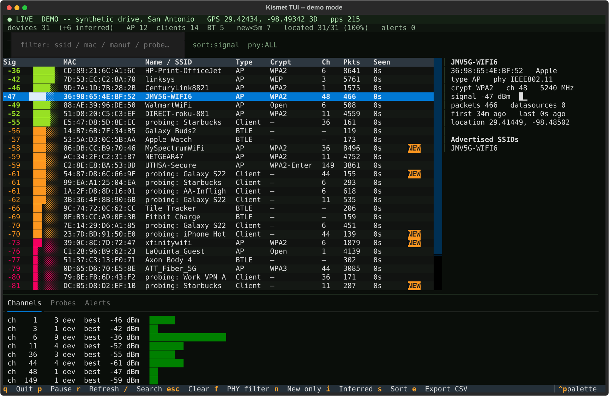

# Kismet TUI

A good-looking, actually-useful terminal UI for [Kismet](https://www.kismetwireless.net/) — built for a wardrive laptop, not a datacenter dashboard.




## Why not just the web UI / Grafana?

Kismet's web UI is great at a desk. In a car, on a Lemur Pro, over a flaky hotspot, you want: one screen, keyboard only, big glanceable counts, and the answer to *"did anything interesting just show up?"* in under a second. That's this.

```
 ● LIVE  http://localhost:2501    GPS 29.42410, -98.49360 3D   pps 412
 devices 37  (+6 inferred)   AP 12  clients 14  BT 5   new<5m 3   located 31/37 (83%)   alerts 2
 ┌──────────────────────────────┬───────────────────────────────┐
 │ Sig  ▓▓▓▓▓▓░░  MAC  SSID …   │ CoffeeShop                    │
 │ -47  ██████░░  AA:BB:…       │ signal -47 dBm  ▁▃▅▇▅▃        │
 │ …                            │ Advertised / Probing / Clients│
 ├──────────────────────────────┴───────────────────────────────┤
 │ Channels │ Probes │ Alerts      (tabbed bottom pane)         │
 └──────────────────────────────────────────────────────────────┘
```

## The one opinion baked in

**Inferred devices are not heard devices.** In a real `.kismet` log, roughly half the Wi-Fi rows can be inferred/bridged/VRRP entries that never transmitted — signal `0`, `0` packets, location `0,0` forever. Tools that count them inflate your numbers and lie about coverage.

So here they are:

- hidden by default, but **counted separately** in the stats strip (`+N inferred`)
- one keystroke (`i`) brings them back
- flagged `INFERRED — never heard transmitting` in the detail pane
- `located %` is computed only over devices actually heard

## Run it

```bash
cd kismet-tui
./run.sh --demo            # synthetic San Antonio drive, no radio needed
./run.sh                   # live Kismet at http://localhost:2501
./run.sh --url http://192.168.1.20:2501 --user kismet --password …
./run.sh --db ~/Kismet-20261022.kismet     # offline log (read-only, WAL-safe
                                           # while Kismet is still writing it)
```

`run.sh` creates `.venv/` and installs the single dependency (Textual) on first run. The Kismet client itself is stdlib-only.

No Textual handy? The parsing core (`kismet_tui/models.py`, `client.py`, `demo.py`) has zero third-party imports and is unit-tested without the UI.

## Keys

| Key | Thing |
|---|---|
| `/` | focus filter (SSID / MAC / manuf / probed SSID) |
| `Esc` | clear filter |
| `f` | cycle PHY filter: all → Wi-Fi → Bluetooth |
| `n` | new-only (< 5 min) |
| `i` | show/hide inferred |
| `s` | cycle sort: signal → packets → last seen → name |
| `S` | reverse the current sort direction (label shows ↓/↑) |
| `u` | release / re-grab the selection — released means no device anchor: the highlight disappears and the device table freezes exactly where it is (stats strip, channels, probes, GPS stay live; label shows `RELEASED`). Moving with ↑/↓ also re-grabs, rebuilding the table from current data |
| `p` | pause polling · `r` resume/refresh now |
| `e` | export visible devices to `~/kismet-tui-export-<ts>.csv` |
| `↑↓` | move between devices (detail pane follows) |
| `q` | quit |

## Panes

- **Stats strip** — heard vs inferred, AP/client/BT split, new-in-5-min, located %, alert count. The located % is the honest health metric for a run.
- **Device table** — signal with bar + color (green ≥ −55, yellow ≥ −70, red below), NEW badge, age since last seen.
- **Detail** — signal-history sparkline, advertised SSIDs, **probed SSIDs**, associated clients, first/last seen, location (or an explicit "never located").
- **Channels** (bottom tab) — devices per channel + strongest signal: find the crowded channels and the empty ones.
- **Probes** — probed SSIDs aggregated across clients, with how many clients are shouting each one and the strongest heard.
- **Alerts** — Kismet alerts, newest first.

## Architecture

```
kismet_tui/
  models.py   Kismet JSON / .kismet row -> flat Device, Alert. Pure python, tested.
  client.py   KismetClient (REST, stdlib urllib) + KismetDB (sqlite, read-only)
  demo.py     DemoSource -- same poll() interface, synthetic drive
  app.py      Textual UI. Sources are interchangeable: if it has .poll(), it works.
```

All three sources return the same dict — `devices / alerts / gps / status / connected` — so adding a fourth (say, a Wigle CSV replay, or a remote Kismet over Tailscale) is one class, no UI changes.

REST endpoints used (all polled, all fail-soft): `devices/views/all/devices.json`, `system/status.json`, `gps/location.json`, `alerts/wrapped/last-time/-3600/alerts.json`. Signal history is stitched client-side across polls, since REST is stateless.

## Tests

```bash
.venv/bin/pip install pytest
.venv/bin/python -m pytest tests/ -q
```

## Known limits (v0.1)

- Full device list each poll — fine to a few thousand devices; a 10k-device University-Hospital-garage run will want the `last-time` incremental endpoint instead.
- No Kismet *control* (no datasource/channel hopping changes) — read-only by design, like the Grafana exporter.
- Channel pane is counts, not a spectrum waterfall. Kismet doesn't give you a waterfall over REST anyway.

## Changelog

**0.1.3** — release-the-selection: normally the viewport is anchored to the highlighted device (each refresh re-finds it and scrolls it back into view, so on a busy scan your view sinks as that device ages). `u` releases it: no anchor, no highlight, and the device table freezes exactly where it is — while the stats strip and the other panes keep updating from live polls, so the scan visibly stays alive. (The table freezes rather than updating in place because DataTable insists on scrolling to its cursor on every rebuild; a frozen table is the honest version of "nothing moves under me.") The detail pane shows strongest/freshest instead. Any cursor movement re-grabs and rebuilds the table from current data.

**0.1.2** — reversible sorts: `S` flips the current sort's direction (numeric sorts default descending, name ascending; cycling with `s` resets to the natural direction). The filter label shows the direction as ↓/↑.

**0.1.1** — the "everything is inferred" fix. v0.1.0's parser was written against an invented record shape and read signal from a top-level `kismet.common.signal` map Kismet never sends, so every real device parsed as signal 0 / packets 0 and landed in the inferred bucket. Fixed against ground truth (a real 19,007-device `.kismet` log + the field paths the Kismet web UI and the kismet-grafana exporter actually use): signal from `kismet.device.base.signal`, packets from the flat `kismet.device.base.packets.total`, location from `base.location → avg_loc → geopoint [lon, lat]`, GPS from the same geopoint shape, full type strings ("Wi-Fi AP") categorised properly. Also fixed: the `.kismet` reader returning zero devices (sqlite returns the device column as bytes), SSID extraction inventing SSIDs out of record fields like "HT20"/"US", packet rate now derived from packet-total deltas, and `.kismet` re-parsing is cached on file mtime/size. The test fixtures are now built from the real record structure — that's the actual lesson here.

## License

MIT, do what you want. Built for shits and grins, kept because it's useful.
